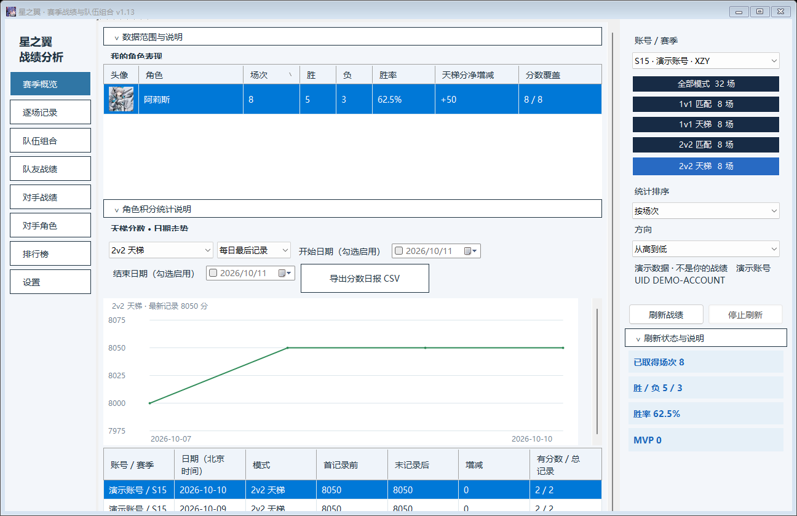
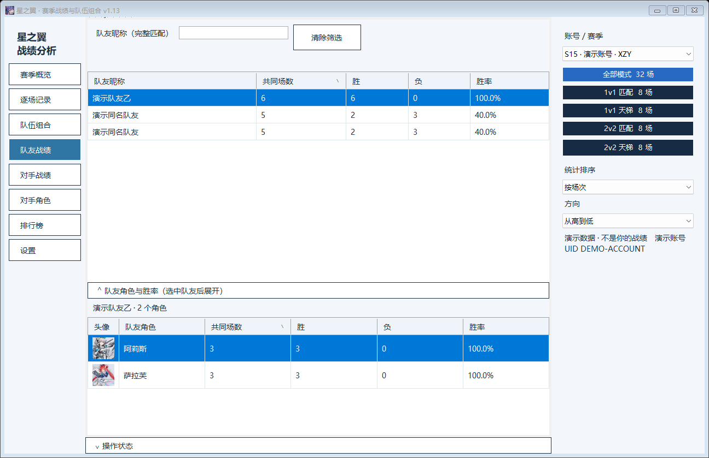

# 星之翼战绩分析 / Starward Battle Journal

一款支持 **Windows 和 Android** 的《星之翼》非官方战绩分析工具。获取并整理官网战绩，分析角色表现、队伍组合、队友与对手胜率，回顾天梯分数变化。

**English:** An unofficial Starward match analysis tool for Windows and Android, featuring match sync, multi-account and season analysis, character and team win rates, ranked score trends, and leaderboards.

**日本語:** Windows / Android 対応の『星之翼』非公式戦績分析ツール。戦績同期、複数アカウント・シーズン分析、キャラ・編成別勝率、ランクポイント推移、ランキング閲覧に対応。

## 功能

- **战绩获取与合并**：从官网登录后获取当前或历史赛季战绩；支持 JSON 导入、重复记录去重及缺失详情补齐。赛季概览可刷新新增战绩。
- **多账号、多赛季**：账号与赛季分别保存，也可选择范围汇总；支持多个独立官网账号网页，减少切换登录。
- **四种对战模式**：1v1 匹配、1v1 天梯、2v2 匹配、2v2 天梯分别统计，也可查看全部模式合计。
- **角色与阵容分析**：查看角色场次、胜率、天梯分净增减，以及角色对位、我方组合与敌方组合的胜率。
- **队友与对手统计**：按昵称选择玩家，查看共同作战或交手的场数、胜率；队友下拉列表按场次排列。PC 队友与对手角色统计可独立展开，每个角色一行。
- **逐场记录与详情**：我方在左、敌方在右，中间显示胜负与本人分数增减；展示各玩家分数及官网返回的输出、解围、击败、被击败等数据。
- **分数走势与排行榜**：赛季概览底部展示按日或逐场的分数图表；排行榜支持国服、亚服、日本服，两种天梯分别查看，可刷新并显示你与榜上玩家的交手统计。
- **界面与导出**：角色头像、场次／胜率排序、深浅主题、七档字号、可折叠说明；支持统计 CSV 导出和全部赛季 JSON 备份。界面只显示本人 UID，隐藏其他玩家 UID。

## 安装

### Windows

解压 PC 版 ZIP，运行 `星之翼战绩分析.exe`。请保留完整目录，包括 `avatars`、官网指南与相关脚本。官网账号网页功能需要 Edge 或 Chrome。

### Android

安装 APK，需要 **Android 8.0 或更新版本**。升级时可使用同签名新版 APK 覆盖安装；卸载前请先备份战绩。

## 使用方法

1. 打开 **设置 → 官网获取战绩**，在官网页面登录并绑定游戏角色，选择赛季后获取；也可直接导入已有战绩 JSON。
2. 在 PC 右侧栏或安卓顶部选择账号、赛季及对战模式，然后通过 PC 左侧菜单或安卓底部菜单查看各类统计。
3. 在 **赛季概览 → 刷新战绩** 获取新增对局及不完整详情。首次使用或登录失效时，按提示完成官网验证。
4. 通过 **设置** 导出 CSV、备份全部赛季，或调整主题和文字大小。PC 与安卓的战绩 JSON 可互相导入。

## 数据口径

- 胜率为已取得记录中的胜场数 ÷ 场次数；全部模式合计按总胜场与总场次计算。
- 队友胜率是你与该队友共同参战的胜率；对手及排行榜胜率是**你对该玩家的胜率**。
- 1v1 角色对位使用双方出战阵容共同出现时的整场结果；2v2 个人对位使用本人角色。队伍组合中的 A+B 与 B+A 合并，A+A 保留。
- 跨账号汇总按各账号视角累计，同一局可能分别计入多个账号。分数走势按账号、赛季与天梯模式分别展示。
- 角色天梯分净增减为已记录的本人战后分减战前分之和。1v1 阵容角色共享该局分差，不应将各角色分差相加作为账号总分差。
- 官网分页结束不代表整赛季战绩齐全。统计以实际取得的记录为准，缺失场次不会补造；榜单目前每张返回前 100 名。
- 1v1 与 2v2 的详情字段不同，缺失项目显示“未记录”。吸锁定按接口比例展示，不能直接当作秒数；目前已验证战绩数据未提供角色铭刻等级。

## 备份与升级

PC 升级前关闭旧版，将旧目录中的 `data`、`official-web` 和 `ui-settings.json` 复制到新版目录，可保留战绩、独立网页登录状态及界面设置；也可先备份全部赛季 JSON，再导入新版。

JSON 备份保留完整战绩数据，可能包含玩家 UID；分享前请注意文件内容。统计 CSV 不包含队友／对手 UID。

## 数据来源

战绩与排行榜来自[星之翼官方战绩网站](https://xzy.shengtiangames.com/gamerecords_2/dist/index.html#/pages/record/battle/index)。本项目为非官方个人分析工具，与游戏官方无隶属关系。

## 项目结构与构建

```text
desktop/          Windows Forms 源码、图标、头像和构建脚本
android/          Android Java 源码、WebView 页面与构建脚本
tools/official/   官网导出助手、自动刷新脚本与使用指南
tests/            仅使用合成演示数据的测试
docs/             构建与发布说明、演示截图
.github/          Windows 自动构建工作流
```

Windows 源码版本为 **1.13**，Android 源码版本为 **1.13.0**。PC 菜单在左侧，账号、模式、排序与概览操作在右侧；安卓仍使用底部两行菜单。

```powershell
pwsh -File ./desktop/build.ps1
pwsh -File ./tests/run-desktop.ps1
node ./tests/core-smoke.cjs
```

Android 构建、签名及所需工具见 [构建说明](docs/BUILD.md)。成品安装包应上传 GitHub Releases，源码仓库不保存本机战绩、浏览器登录资料、签名密钥和 SDK。上传步骤见 [发布说明](docs/PUBLISH.md)。

## PC 界面示例

以下截图使用合成演示数据：





## 许可与第三方素材

代码许可证尚待作者指定。游戏头像、名称和原游戏图标归各自权利人所有，详见 [NOTICE.md](NOTICE.md)。
